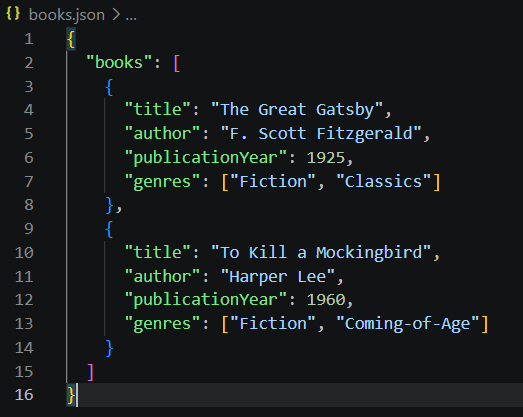
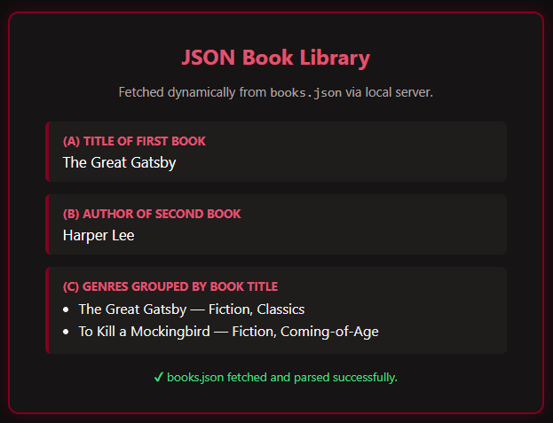
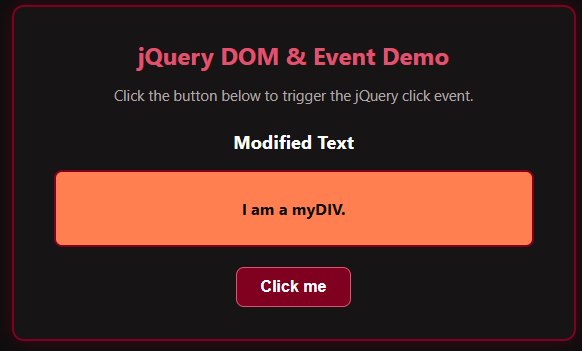
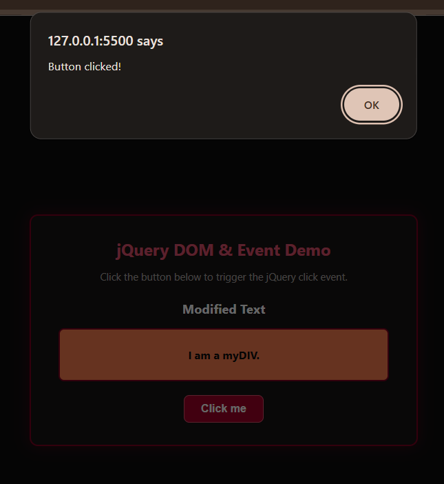

# BIC21203 Web Development — Lab #4b: JSON and jQuery

## Brief Explanation
This repository contains client-side scripting solutions for this lab. It demonstrates how to structure data in JSON format (`books.json`), retrieve and display JSON data safely using the native JavaScript `fetch()` API (`books.html`), and perform DOM manipulation and event handling using jQuery 4.0.0 (`jquery-dom.html`).

---

## Setup & How to Run
1. Clone or download this repository to your local machine.
2. Open the project folder in **Visual Studio Code**.
3. Right-click **`books.html`** and select **"Open with Live Server"** (required so `fetch()` can load `books.json` over HTTP instead of `file://`).
4. Open **`jquery-dom.html`** in your browser or via Live Server and click the **"Click me"** button to test the jQuery click event.

---

## Output Screenshots

### Question 1: JSON Dataset (`books.json`)
| Valid JSON Structure |
| :---: |
|  |

---

### Question 2: Fetch & Display JSON Data (`books.html`)
| Browser Output via Live Server |
| :---: |
|  |

---

### Question 3: jQuery DOM & Event Handling (`jquery-dom.html`)
| Page Loaded (Text & Style Updated) | Button Clicked (`alert` Triggered) |
| :---: | :---: |
|  |  |